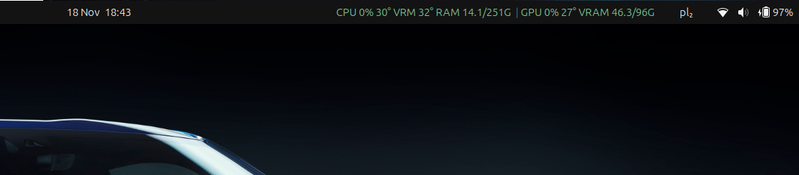

# ai-rig temps widget

Live temperature + fan-speed widget on this laptop, showing the
**ai-rig (192.168.0.74)**.

## Screenshot

The compact read-out sits in the GNOME top bar, leftmost in the right box
(CPU group `|` GPU group); clicking it opens the full menu.



## Architecture

```
[ai-rig :8788]                 [laptop]
temps_server.py ──HTTP JSON──▶ poller.py  ──writes──▶  ~/.cache/ai-rigtemps/data.json
 (sensors + nvidia-smi)          (systemd user svc,            ▲
                                 2s, own process)             │ reads (instant)
                                                  ai-rigtemps@a.local  (GNOME Shell ext,
                                                  top bar: compact read-out + click menu)
```

Three parts, deliberately decoupled so a **dead ai-rig can never freeze
your desktop**:

1. **Server** (`temps_server.py`, on the ai-rig) — systemd **user**
   service `temps-server.service` (enabled + linger). Serves
   `GET /temps` on `0.0.0.0:8788`.
2. **Poller** (`poller.py`, on the laptop) — systemd **user** service
   `ai-rigtemps-poller.service`. Runs in its *own* process, curls the
   endpoint every 2 s and writes the result to
   `~/.cache/ai-rigtemps/data.json`. Its network timeouts live here, not
   in gnome-shell.
3. **Widget** (`extension/ai-rigtemps@a.local`) — GNOME Shell extension.
   Each tick it **reads the local cache file** (instant, no network) and
   renders a compact read-out in the top bar (leftmost in the right box,
   before the system icons). Clicking it opens a menu with all temps +
   fans. If the cache is older than 6 s it shows a red **OFFLINE** badge.

> Why not have the extension curl directly? A blocking
> `spawn_command_line_sync` in gnome-shell's main loop freezes the whole
> desktop for the duration of every failed request. Moving the I/O into
> a separate process eliminates that entirely.
>
> `temps_widget.py` is the earlier GTK3 floating bar — superseded, kept
> for reference only.

## Repo layout

| Path                              | What                                  | Runs on |
|-----------------------------------|---------------------------------------|---------|
| `temps_server.py`                 | JSON server (sensors + nvidia-smi)    | ai-rig  |
| `poller.py`                       | background poller → cache file        | laptop  |
| `ai-rigtemps-poller.service`      | systemd unit for the poller           | laptop  |
| `extension/ai-rigtemps@a.local/`  | GNOME Shell extension (the widget)    | laptop  |
| `extension/install.sh`            | deploy extension + start poller       | laptop  |
| `temps_widget.py`                 | (legacy) GTK3 bar — superseded        | laptop  |

## Install / update (laptop)

```
./extension/install.sh
```
Then **log out and back in** (a GNOME Shell restart) to load the
extension. To re-enable after a restart without re-installing:
```
gnome-extensions enable ai-rigtemps@a.local
```

## Install (ai-rig) — one-time

The server file lives at `~/workspace/ubuntu-temps/temps_server.py` on
the ai-rig. Re-deploy it from this repo if you change it:
```
scp temps_server.py ai-rig:~/workspace/ubuntu-temps/temps_server.py
ssh ai-rig 'systemctl --user enable --now temps-server.service'
```

## Verifying the data path

```
curl http://192.168.0.74:8788/temps | python3 -m json.tool
systemctl --user status ai-rigtemps-poller.service
python3 -c "import json,time; d=json.load(open('/home/m247/.cache/ai-rigtemps/data.json')); print('fresh' if time.time()-d['ts']<6 else 'STALE', round(time.time()-d['ts'],1),'s')"
ssh ai-rig 'nvidia-smi --query-gpu=temperature.gpu,fan.speed --format=csv,noheader,nounits'
```

## Colors / layout

- Bar (compact), percent before temp, CPU group `|` GPU group:
  `CPU 26% 52°  VRM 41°  RAM 14/251G   |   GPU 91% 80°  VRAM 46/96G`
  — leftmost in the right box, before the system icons/clock.
- Menu (full): usage block (`CPU %`, `GPU %`, `RAM`, `VRAM`), then every
  temp (`CPU`, `VRM_E`, `VRM_W`, `NVMe`, `GPU`), then every fan
  (`USB4`, `M.2`, `GPU fan`).
- Temp: `<65` green, `65–79` orange, `≥80` red. Utilization (CPU/GPU %,
  RAM, VRAM): `<65%` green, `65–85%` orange, `≥85%` red. Fans: blue.
- GPU **%** is compute busy (utilization.gpu); `GPU fan` is fan speed.
- ai-rig unreachable → red **OFFLINE** in the bar, empty menu.

## Firewall

`ufw` on the ai-rig allows `tcp 8788` from `192.168.0.0/24`.

## Troubleshooting

- **Desktop lags when the ai-rig is off** → the (old) extension was doing
  blocking I/O on the shell main loop. This version fixes it: confirm the
  poller is the only thing touching the network:
  ```
  systemctl --user status ai-rigtemps-poller.service
  ```
- **Bar shows OFFLINE / stale** → poller or server is down:
  ```
  journalctl --user -u ai-rigtemps-poller.service | tail
  ssh ai-rig 'systemctl --user status temps-server.service'
  ```
- **Extension not updating** → `gnome-extensions show ai-rigtemps@a.local`
  (State should be ACTIVE) and
  ```
  journalctl --user --no-pager | grep -i ai-rigtemps
  ```
  for any `TypeError`. After editing `extension.js`, re-run
  `./extension/install.sh` and log out/in.
